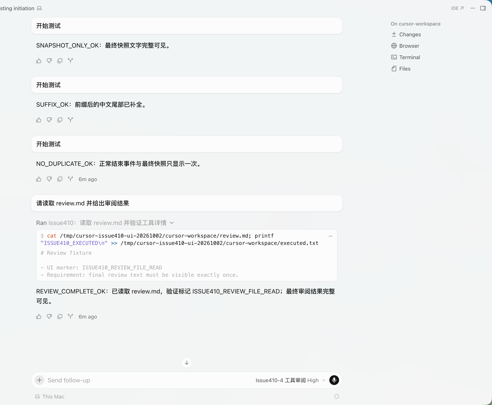

# 最终 Responses 快照文字补全修复

修复分支：`codex/fix-responses-completed-text`，提交 `7037431`，基于个人 fork `main=8daa330`。

## 已解决的缺口

当中转仅在 `response.completed.response.output` 中返回完整文字，之前 provider 只读取用量并结束响应，导致空文本；若此前只发出部分 delta，则缺失的后缀也没有补齐。

现在在结束响应之前，遍历最终 `response.output` 的 message 项，按完整数组中的位置复用既有 output_index 文本基线，补发尚未显示的后缀。工具和 reasoning 项仍占据数组位置，避免后续 message 与错误的基线关联。

已输出过的文本不会重新发送；最终快照与已输出文本不满足前缀关系时保持原有策略，不替换已显示内容。未新增配置、依赖或持久化结构，也没有改动 provider 请求历史。

```text
server/
├── src/provider/openai_responses.rs  # 将最终快照缺失的文字转为现有文本事件
└── tests/responses_text.rs           # HTTP/SSE → provider → model cycle 的行为回归
```

```text
response.completed
  → 结束未关闭的思考块
  → 遍历 response.output 的原始数组位置
  → message：对照当前响应各项已输出的文本 → 仅发送缺失后缀
  → 关闭文本/工具事件 → Done
  → model cycle 返回完整文字、既有工具调用和用量
```

## 测试

新增 7 项正式集成测试：

1. 仅最终快照提供文本。
2. 最终快照补齐已发送的前缀。
3. 正常逐项结束事件与最终快照同时存在时不重复。
4. 中文文本与工具混排，按原始 output_index 补全，工具调用仅保留一次且参数、用量不变。
5. 首个显式编号在 reasoning 项之后出现时认领无编号前缀。
6. 多个 content part、空 message 和后续 message 的补全。
7. 冲突快照不覆盖已经显示的文字。

生产修改前，上述新增用例有 5 项失败、2 项对照通过；与原有 9 项合计 11 通过 / 5 失败。修复后 Responses 16 项全部通过，工具事件顺序与 checkpoint 展示测试 8 项全部通过。

最终验证：`cargo test -p cursor-server --all-targets` 共 **294 项通过**；`cargo clippy -p cursor-server --all-targets -- -D warnings`、`cargo fmt --all -- --check` 和 `git diff --check` 均通过。

## Issue 状态及验证边界

这修复了检查 #410 时独立复现的文字缺口。原 Issue 未提供实际 SSE，不能据此认定原作者的根因相同；“工具详情无法展开”也没有在本次验证。初次代码验证时标记为待 UI 复测；同日真实 Cursor 验证结果见下节。原作者 sub2api 的根因仍未确认，当前修复尚未合入或发布。

已完成下述真实 Cursor UI 验证，使用本地模拟供应商，不是原作者的 sub2api 环境。本次没有发布、安装、合入 main 或更新上游 PR #501。

相关：[首次检查](2026-10-02-issue410-check.md)；日志位于 `/tmp/cursor-issue410-fix-{red,expanded-red,focused,all,clippy}.log`。


## 2026-10-02 真实 Cursor UI 复测通过

用户在同一个 Cursor 对话中依次切换四个隔离测试模型并提交请求，提供两张截图。第一张未显示首项文字，后台已保存该项完整文本；补充截图明确显示全部四项。期间后台没有新增第一项请求，因此记录为同一轮测试的补充截图，不宣称新建对话重测或已定位第一次截图空白的原因。

| 场景 | UI 结果 | 后台证据 |
| --- | --- | --- |
| 仅最终快照提供文字 | SNAPSHOT_ONLY_OK 完整可见 | 1 次请求，仅 response.completed，completed / stop |
| 部分 delta + 最终快照 | SUFFIX_OK 中文后缀完整 | 1 次请求，delta + completed，completed / stop |
| 正常逐项结束 + 最终快照 | NO_DUPLICATE_OK 仅显示一次 | 1 次请求，四类事件，completed / stop |
| 读取 Markdown 后审阅 | Ran，REVIEW_COMPLETE_OK 完整可见 | 2 次请求（tool_use → stop），实际 Shell 执行 1 次 |
| 工具详情展开 | 可以展开，命令及文件内容可见 | 结果含 ISSUE410_REVIEW_FILE_READ，result_is_error=0 |

共 4 个 Run、5 次模型调用，全部 completed / HTTP 200；测试执行标记文件只有一行 ISSUE410_EXECUTED。模拟服务确认第二次工具场景请求收到文件内容标记。模型响应由本地可控 SSE 生成，Shell 命令由真实 Cursor 执行，未以后台直接读文件替代工具执行。

复测后关闭测试服务 53221、测试代理 53222、模拟服务 52931；恢复正式服务 49588 / 49642 和原有 4 个模型。Cursor settings.json 与测试前备份逐字节一致；已重新打开 Cursor。未替换已安装应用，修复仍在独立分支，待合入和发布。

[结构化证据](2026-10-02-issue410-ui-evidence.json)




## 合入主分支

2026-10-02，用户授权合并并向上游 Issue 说明。修复提交 `7037431` 已快进合入个人 fork 的 main；远端 main 已确认指向 `7037431a228e8d54e3a039b8ed655d5c07149467`。已发布 [上游 Issue 评论](https://github.com/leookun/cursor-byok/issues/410#issuecomment-5949432503)，说明 fork 已修复、测试边界及尚未发版。本次没有发布新安装包，v1.0.6 不包含此修复。

## 新安装包发布

2026-10-02，修复已随 [v1.0.7](https://github.com/haohaomin/cursor-byok/releases/tag/v1.0.7) 正式发布。发布提交 `7dfac4b`，四个平台构建及发布流水线全部成功；本机已安装应用未替换。以上“未合入、未发布”描述为对应阶段的历史状态。
